<a href="https://daeseungpark.com">
  
</a>

<p align="center">
  <a href="https://daeseungpark.com"></a>
  <a href="https://scholar.google.com/citations?hl=ko&user=qVom0QUAAAAJ"></a>
  <a href="https://orcid.org/0009-0002-3044-2689"></a>
  <a href="https://www.linkedin.com/in/daeseungpark"></a>
  <a href="https://huggingface.co/daeseungpark"></a>
  <a href="https://hub.docker.com/u/daeseungpark"></a>
  <a href="https://codespectrum.net"></a>
  <a href="mailto:dspark@daeseungpark.com"></a>
</p>

<br/>

```python
class DaeseungPark(Researcher):
    alias       = ("Universe Maker", "The Green Eye")
    role        = "AI & Software Systems Engineer"
    affiliation = "KAIST · Convergence Research Center, Information & Electronics Research Institute"
    based_in    = "Daejeon, Korea 🇰🇷"
    motto       = "문제의 본질을 코드로 옮긴다."          # turning the essence of a problem into code
    working_on  = ["Generative AI & LLMs", "Time-series forecasting", "Conversational AI",
                   "Knowledge graphs & GeoLLM", "mmWave indoor sensing", "Distributed simulation"]
    reach_me_at = ["dspark@daeseungpark.com", "dspark@kaist.ac.kr"]
    side_quest  = "In my free time I build small, useful tools — and ship them right here."
```


## 🔭 Research Universe


## 📡 Latest Transmissions

| | Signal | What happened |
|:-:|---|---|
| 🆕 | **IEEE Access** | Distributed mmWave radar for indoor human detection & geo-referencing — [read the paper →](https://daeseungpark.com/works/ieee-access-distributed-mmwave/) |
| 🎤 | **ICECCME 2026** · Bali | Predictive load-balancing simulation with spatiotemporal graph neural networks (Oct 15–17, 2026) — [details →](https://daeseungpark.com/works/iceccme2026-predictive-load-balancing/) |
| 🧪 | **Abliterated AI** | Public trial of an abliterated (uncensored) model for AI-safety research — [try it →](https://ai.daeseungpark.com/chat/) |
| 🔬 | **LLM Research Platform** | Hosted workbench for testing and comparing LLMs — [open →](https://service.daeseungpark.com/rchat) |

<details>
<summary><b>🚀 Current R&D missions</b> &nbsp;<sub>(click to expand)</sub></summary>
<br/>

| Mission | Sponsor | Period |
|---|---|---|
| City-safety AI models — development & field validation | Ministry of Trade, Industry and Energy | 2026.04 – 2026.12 |
| K-AIX: address-intelligence ecosystem model | Ministry of Land, Infrastructure and Transport · LX | 2025.12 – 2026.03 |
| Data-intelligence generation & operation | Ministry of the Interior and Safety | 2025.06 – 2026.12 |
| AI-based digital-twin healthcare platform | Daejeon Metropolitan City · Daejeon TP | 2025.04 – 2025.12 |

</details>

## 🛰️ Featured Work

<table>
<tr>
<td width="50%" valign="top">

**🕸️ [AddressKG](https://daeseungpark.com/works/pf-addresskg/)**<br/>
<sub>National address knowledge graph on a national-standard ontology.</sub><br/>
  

</td>
<td width="50%" valign="top">

**🚨 [City-Safety AI API](https://daeseungpark.com/works/pf-citysafety-ai-api/)**<br/>
<sub>Multimodal LLM serving for disaster perception across video, sensor, spatial and text data.</sub><br/>
 

</td>
</tr>
<tr>
<td valign="top">

**🧪 [Universal LLM Test & Research Platform](https://github.com/UniverseMaker/Universal-LLM-Test-Research-Platform)**<br/>
<sub>Bring-your-own-key workbench for any OpenAI-compatible API: chat, hybrid & graph RAG, agents, evaluation, full request inspector.</sub><br/>
 

</td>
<td valign="top">

**🔐 [Universal Login & SSO Server](https://github.com/UniverseMaker/Universal-Login-SSO-Server)**<br/>
<sub>Sign in once and get per-service secrets from the server, so API keys never ship in your frontend. PHP 7.2+, one MySQL DB.</sub><br/>
 

</td>
</tr>
<tr>
<td valign="top">

**✍️ [Unslop](https://github.com/UniverseMaker/Unslop)**<br/>
<sub>An AI-assisted Korean copy-editing tool for work and research documents (업무·연구자 전용 AI 윤문 도구).</sub><br/>
 

</td>
<td valign="top">

**🏢 [AI Office](https://github.com/UniverseMaker/AI-Office)**<br/>
<sub>DSPark's AI Office: a personal, self-hosted workspace for running AI tools in one place.</sub><br/>
 

</td>
</tr>
<tr>
<td valign="top">

**💾 [EyeDrive](https://github.com/UniverseMaker/EyeDrive)** <br/>
<sub>Mount a WebDAV server as a real local drive on Windows 10/11 (rclone-based), fast enough for dev tools.</sub><br/>


</td>
<td valign="top">

**🖥️ [ResSwitch](https://github.com/UniverseMaker/Display-Resolution-Changer-ResSwitch)**<br/>
<sub>One-click and scheduled display-resolution switcher for Chrome Remote Desktop, with multi-monitor profiles.</sub><br/>


</td>
</tr>
</table>

<p align="right"><sub>…and <a href="https://github.com/UniverseMaker?tab=repositories">more in the repositories tab →</a></sub></p>

## 🧰 Toolchain

<table>
<tr><td align="right"><sub><b>AI / ML</b></sub></td><td>


</td></tr>
<tr><td align="right"><sub><b>Languages</b></sub></td><td>

</td></tr>
<tr><td align="right"><sub><b>Backend & Data</b></sub></td><td>


</td></tr>
<tr><td align="right"><sub><b>Infra & Cloud</b></sub></td><td>

</td></tr>
<tr><td align="right"><sub><b>Devices & Apps</b></sub></td><td>

</td></tr>
</table>

## 📊 Mission Telemetry


<picture>
  <source media="(prefers-color-scheme: dark)" srcset="https://raw.githubusercontent.com/UniverseMaker/UniverseMaker/output/snake-dark.svg" />
  <source media="(prefers-color-scheme: light)" srcset="https://raw.githubusercontent.com/UniverseMaker/UniverseMaker/output/snake-light.svg" />
  
</picture>

## ☕ Fuel the Rocket

<p>
  <a href="https://ko-fi.com/daeseungpark"></a>
  <a href="https://buymeacoffee.com/daeseungpark"></a>
</p>


