<a href="https://daeseungpark.com"></a>

<a href="https://orcid.org/0009-0002-3044-2689"></a>

<a href="https://huggingface.co/daeseungpark"></a>
<a href="https://hub.docker.com/u/daeseungpark"></a>
<a href="https://codespectrum.net"></a>
<a href="mailto:dspark@daeseungpark.com"></a>


<a href="https://daeseungpark.com/works.html"></a>

### 

<a href="https://daeseungpark.com/research.html"></a>

### 

<a href="https://daeseungpark.com/works/ieee-access-distributed-mmwave/"></a>
<a href="https://daeseungpark.com/works/iceccme2026-predictive-load-balancing/"></a>
<a href="https://ai.daeseungpark.com/chat/"></a>
<a href="https://service.daeseungpark.com/rchat"></a>

<b>Current R&D missions</b> &nbsp;(click to expand)

 

| Mission | Sponsor | Period |
|---|---|---|
| City-safety AI models: development & field validation | Ministry of Trade, Industry and Energy | 2026.04 – 2026.12 |
| K-AIX: address-intelligence ecosystem model | Ministry of Land, Infrastructure and Transport · LX | 2025.12 – 2026.03 |
| Data-intelligence generation & operation | Ministry of the Interior and Safety | 2025.06 – 2026.12 |
| AI-based digital-twin healthcare platform | Daejeon Metropolitan City · Daejeon TP | 2025.04 – 2025.12 |

### 

<!-- JOURNAL:START -->
<a href="https://daeseungpark.com/articles/ontology-schema-first-knowledge-graph/"></a>
<a href="https://daeseungpark.com/articles/address-graph-disaster-perception-stack/"></a>
<a href="https://daeseungpark.com/articles/rag-architectures-hallucination/"></a><!-- JOURNAL:END -->

### 

<a href="https://daeseungpark.com/works/pf-addresskg/"></a>
<a href="https://daeseungpark.com/works/pf-citysafety-ai-api/"></a>
<a href="https://github.com/UniverseMaker/Universal-LLM-Test-Research-Platform"></a>

<a href="https://github.com/UniverseMaker/Unslop"></a>
<a href="https://github.com/UniverseMaker/AI-Office"></a>
<a href="https://github.com/UniverseMaker/EyeDrive"></a>
<a href="https://github.com/UniverseMaker/Display-Resolution-Changer-ResSwitch"></a>

…and <a href="https://github.com/UniverseMaker?tab=repositories">more in the repositories tab →</a>

### 


### 


<picture>
  <source media="(prefers-color-scheme: dark)" srcset="assets/snake-dark.svg" />
  <source media="(prefers-color-scheme: light)" srcset="assets/snake-light.svg" />
  
</picture>

### 

<a href="https://ko-fi.com/daeseungpark"></a>
<a href="https://buymeacoffee.com/daeseungpark"></a>

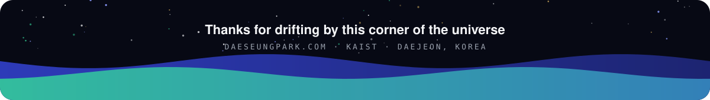
